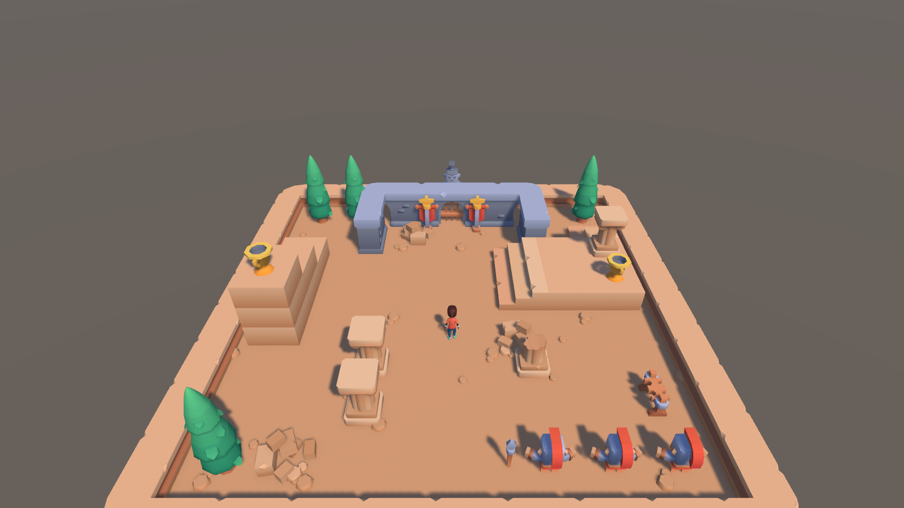
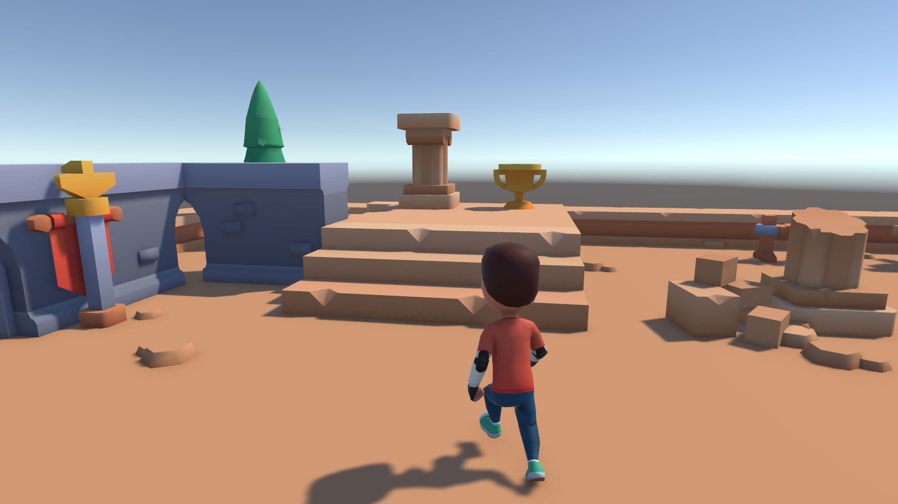
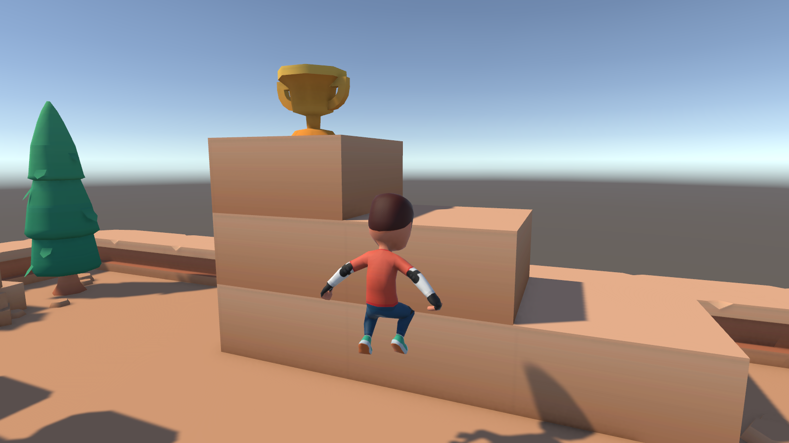
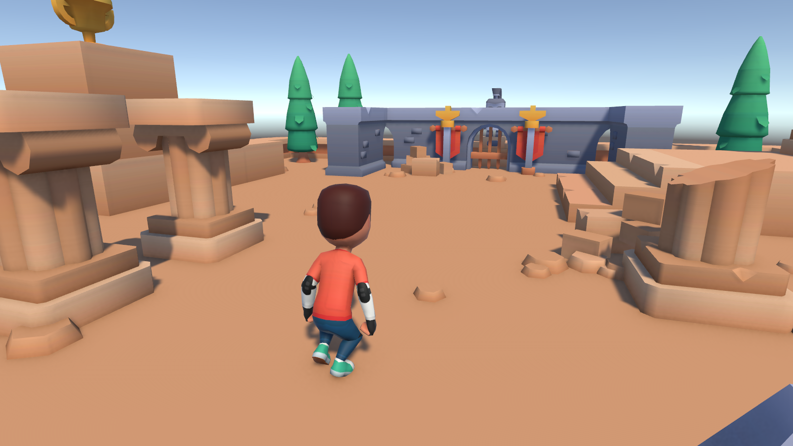
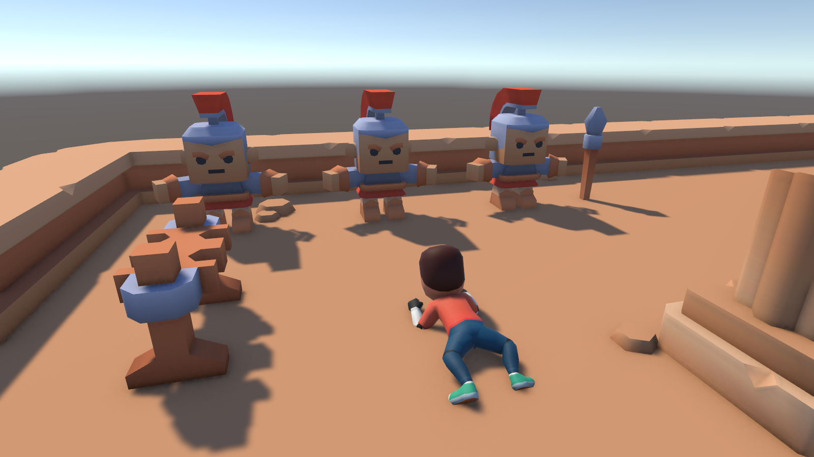
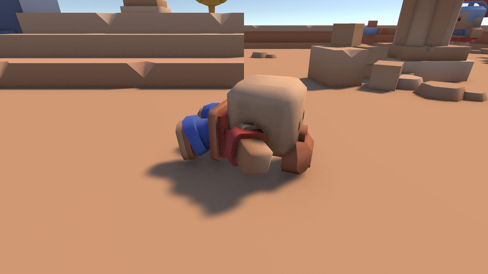
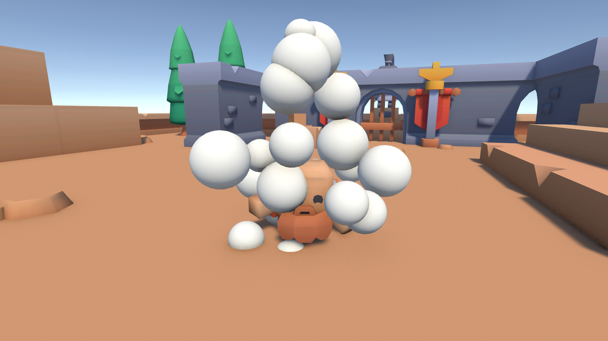

# Arrow Game

A third-person 3D prototype built with **Unity 6**. Like its sibling project Blackhole, it is also an experiment in **agentic game development**: the code, scene edits, Inspector wiring and even the custom animations were made by AI agents, guided by a human who designs, play-tests and decides.

The game design is not set yet. Right now the project is a movement playground: a small arena to walk, run, jump, crouch and crawl around in, with two characters to switch between.

| | |
|---|---|
| **Engine** | Unity `6000.6.0f1`, URP (Universal Renderer) |
| **Input** | Input System only (legacy Input Manager disabled) |
| **Characters** | Skater (Kenney Animated Characters Protagonists) and Bearded (Kenney Mini Characters), switchable in the Esc menu |
| **Arena** | Kenney Mini Arena (CC0) |
| **Animation** | Kenney idle, run and jump clips; crouch and prone clips for both characters generated by the agent |

## Screenshots

| | |
|---|---|
|  |  |
|  |  |
|  |  |

## Controls

| Key | Action |
|---|---|
| **W A S D** | Move (relative to the camera) |
| **Mouse** | Orbit the camera around the player |
| **Shift** | Sprint |
| **Space** | Jump |
| **C** | Crouch / stand up |
| **X** | Go prone / stand up |
| **E** | Switch to the next character |
| **Esc** | Open / close the menu (switch characters) |

## Characters

| Character | Model | Height |
|---|---|---|
| **Skater** | Kenney Animated Characters Protagonists | 2 m |
| **Bearded** | Kenney Mini Characters (`character-male-b`) | 1 m |

Press **E** to switch to the next character, or press **Esc** and pick one from the menu. Key hints sit in the bottom-right corner of the screen. The switch happens inside a puff of white cloud. Each character has its own collision capsule, camera height and animation speeds, so a small character also fits through smaller gaps.

## Getting started

1. Open the project with **Unity 6000.6.0f1**.
2. Open `Assets/Scenes/MainScene.unity` and press **Play**.
3. Tune values in the Inspector:
   - Movement: `Player` → `Player Controller`
   - Collision capsule and camera height per character: `Player` → `Character Selector`
   - Animation speeds: `Player/Model` and `Player/MiniModel` → `Player Animator`
   - Camera feel: `Main Camera` → `Third Person Camera`
   - Switch puff: `Player/SwitchPuff` (Particle System)

## Project layout

| Folder | Contents |
|---|---|
| `Assets/Scripts/Player/` | Movement, stances, animation parameters and character switching |
| `Assets/Scripts/UI/` | Esc menu behavior |
| `Assets/Scripts/Camera/` | Third-person orbit camera with collision |
| `Assets/Animations/` | Animator Controller, the mini character's override controller and the generated crouch and prone clips |
| `Assets/Models/` | Kenney model packs, one folder per pack |
| `Assets/Materials/` | Character skin and the white puff material |
| `Assets/UI/` | Esc menu and key-hint HUD layouts (UXML), styles (USS) and Panel Settings |
| `Assets/Editor/` | Project validator (**Tools → ArrowGame → Validate Project**) |
| `Tools/agent/` | Helper scripts the agents use to verify their changes |
| `docs/screenshots/` | Images for this README |

## Working with agents

The rules every agent follows are in [`AGENTS.md`](AGENTS.md) (`CLAUDE.md` points to it). Each change is checked with `Tools/agent/unity-check.py`: it waits for Unity to compile, reports new Console errors, scans the changed code for forbidden patterns and runs the project validator.

## Credits

Character and arena models by [Kenney](https://kenney.nl) (CC0).
